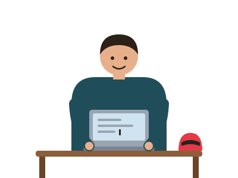

# Hi there 👋 I'm Ahlad

## About me

Digital accessibility specialist working remotely. I audit websites and apps against WCAG and prepare VPAT and ACR documentation so digital products work for everyone.

## Expertise

Experienced in handling tough and complex components, making them usable for people who rely on screen readers and keyboards. Screen reader testing with NVDA and JAWS, and work against Section 508, ADA, and the EU Accessibility Act.

## Certifications

DHS accessibility certification, and a W3C accessibility certification through edX.

## Events

Attended GAAD (Global Accessibility Awareness Day) and other accessibility and AI testing events.

## Connect with me

